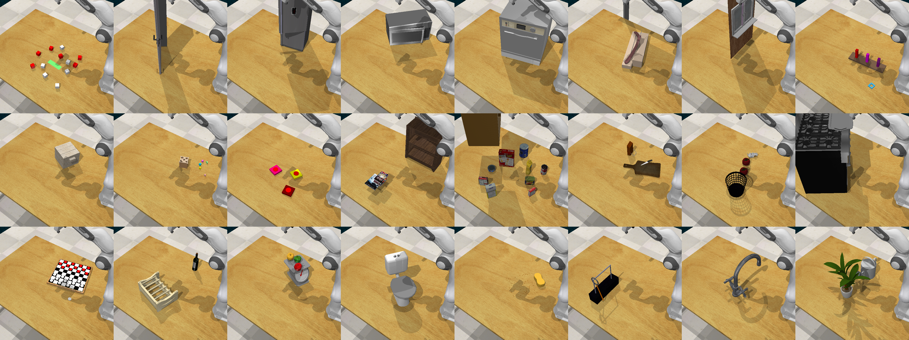

# RLBench: Robot Learning Benchmark [](https://github.com/stepjam/RLBench/actions) [](https://github.com/stepjam/RLBench/actions) [](https://discord.gg/DXPCjmd)



**RLBench** is an ambitious large-scale benchmark and learning environment 
designed to facilitate research in a number of vision-guided manipulation
research areas, including: reinforcement learning, imitation learning,
multi-task learning, geometric computer vision, and in particular, 
few-shot learning. [Click here for website and paper.](https://sites.google.com/corp/view/rlbench)

# Integration

This directory integrates RLBench as a native-action benchmark for StarVLA.
RLBench owns action semantics: StarVLA consumes images and language, emits a
raw vector of the configured size, and the adapter validates that vector
against `ActionMode.action_shape(scene)` before passing it unchanged to
`TaskEnvironment.step()`. It does not convert joint actions to an
end-effector representation, use Euler-angle re-encoding, or impose a global
7D action layout.

## Experimental Results

We use the established nine-task multi-task protocol below. The task labels
map to the RLBench task files as follows: Sweep Dirt -> `sweep_to_dustpan`,
Screw Bulb -> `screw_nail`, and Put in Board -> `insert_onto_square_peg`.

| Model | Action Mode | Steps | Epochs | Push Buttons | Stack Blocks | Open Drawer | Close Jar | Stack Cups | Sweep Dirt | Slide Block | Screw Bulb | Put in Board | Avg. |
| --- | --- | ---: | ---: | ---: | ---: | ---: | ---: | ---: | ---: | ---: | ---: | ---: | ---: |
| LLARVA | Published RLBench protocol | - | - | 56 | 0 | 60 | 28 | 0 | 84 | 100 | 8 | 0 | 37.3 |
| PerAct | Published RLBench protocol | - | - | 48 | 36 | 80 | 60 | 0 | 56 | 72 | 24 | 16 | 43.6 |
| StarVLA-OFT | JointVelocity + Discrete | running | - | - | - | - | - | - | - | - | - | - | - |

The LLARVA and PerAct rows are published baselines copied from the classic
RLBench multi-task results referenced in **RLBench Multi-Task success rate (%)**。([OpenReview][1]).
They are not StarVLA measurements. The StarVLA row remains blank until the
currently running native-action experiment has completed evaluation; do not
compare it with the published rows until the same task split, rollout budget,
and success criterion are recorded.

Action mode is intentionally part of the table. It is an experimental variable
because `JointVelocity`, `JointPosition`, `JointTorque`,
`EndEffectorPoseViaIK`, and `EndEffectorPoseViaPlanning` have different
physical meanings even when their Panda action vectors happen to be 8D.

## 1. Environment Setup

Use a dedicated Python 3.10 environment for the benchmark. RLBench 1.2.0 and
CoppeliaSim 4.1.0 are the versions exercised by this integration.

```bash
conda create -n starvla-rlbench python=3.10 -y
conda activate starvla-rlbench
cd /path/to/starVLA
pip install -e .
pip install git+https://github.com/stepjam/RLBench.git

export COPPELIASIM_ROOT=/path/to/CoppeliaSim
export LD_LIBRARY_PATH="$LD_LIBRARY_PATH:$COPPELIASIM_ROOT"
export QT_QPA_PLATFORM_PLUGIN_PATH="$COPPELIASIM_ROOT"
```

<details>
<summary><b>⚠️ Common Issues</b></summary>

- **Headless server has no display:** Run CoppeliaSim through `xvfb-run`, for
  example with `xvfb-run -a -s "-screen 0 1280x1024x24" ...`.
- **A job runs inside an old tmux session:** Do not reuse a stale `DISPLAY`
  value copied into that session. Start the command with a fresh Xvfb display
  (using `xvfb-run`) so the GUI and OpenGL environment are created together.
- **CoppeliaSim 4.1.0 vision sensors fail to initialize:** Do not set
  `QT_QPA_PLATFORM=offscreen`. Vision sensors require the OpenGL context
  provided by Xvfb; the offscreen Qt platform cannot create the required
  context.
- **OpenGL or camera failures are unclear:** Run the verification commands
  below. `glxinfo -B` should report a working renderer before running RLBench.

</details>

The following commands have been verified on the shared server using the
`starvla` environment:

```bash
xvfb-run -a -s "-screen 0 1280x1024x24" glxinfo -B
python -m unittest tests.test_rlbench_adapter -v
python examples/simBenchmarks/RLbench/eval_files/resolve_action_dim.py \
  --config examples/simBenchmarks/RLbench/configs/env/joint_velocity.yaml
```

The last command emits `RLBENCH_ACTION_DIM=8` for the default Panda
JointVelocity + Discrete configuration.

## 2. Action Mode Configuration

The selected RLBench mode determines the model action dimension at runtime.
The included [joint-velocity configuration](configs/env/joint_velocity.yaml) is:

```yaml
env:
  name: rlbench
  camera_names: [front_rgb]
  action_mode:
    type: MoveArmThenGripper
    arm: {type: JointVelocity, kwargs: {}}
    gripper: {type: Discrete, kwargs: {}}
```

Supported arm modes are `JointVelocity`, `JointPosition`, `JointTorque`,
`EndEffectorPoseViaIK`, and `EndEffectorPoseViaPlanning`. `Discrete` and
`Continuous` grippers are used when exposed by the installed RLBench version.
RLBench 1.2.0 exposes `Discrete` but not `Continuous`; a request for an
unavailable native mode fails explicitly instead of silently changing its
semantics.

For every run, `Environment.action_shape()` is the action-head contract.
Panda joint and pose modes plus a scalar gripper are 8D, not the historic
StarVLA 7D convention. The training dataset, dataset statistics, checkpoint,
and evaluator must use the exact same action-mode configuration.

## 3. Checkpoint Download

Download a vision-language base model before training. For the default OFT
recipe, use Qwen3-VL-2B-Instruct:

```bash
source /etc/profile.d/isee-sci-net.sh 2>/dev/null || true
SCI_NET on 2>/dev/null || true
export http_proxy=http://192.168.1.13:10809
export https_proxy=http://192.168.1.13:10809

huggingface-cli download Qwen/Qwen3-VL-2B-Instruct \
  --local-dir playground/Pretrained_models/Qwen3-VL-2B-Instruct
```

If the configured proxy is unavailable, clear proxy variables and test direct
access before attempting a large download. The shared server already contains
`playground/Pretrained_models/Qwen3-VL-2B-Instruct`; reuse it instead of
downloading another copy. Do **not** use the available LIBERO checkpoints for
RLBench: they were trained with 7D LIBERO actions and their normalization
statistics are incompatible with this benchmark.

## 4. Native-Action Data Preparation

Collect RLBench expert demonstrations with the same mode that will be used by
training and evaluation. The official generator currently uses
`JointVelocity + Discrete`, matching the default configuration:

```bash
export RLBENCH_ROOT=/path/to/RLBench
export RAW_ROOT=playground/Datasets/RLBench_raw/joint_velocity_9task

xvfb-run -a -s "-screen 0 1280x1024x24" \
  python "$RLBENCH_ROOT/rlbench/dataset_generator.py" \
  --save_path "$RAW_ROOT" \
  --tasks push_buttons stack_blocks open_drawer close_jar stack_cups \
          sweep_to_dustpan slide_block_to_target screw_nail insert_onto_square_peg \
  --image_size 128 128 --renderer opengl --processes 1 \
  --episodes_per_task 100 --variations 1
```

The raw generator output is not directly a StarVLA training dataset. Convert
it to LeRobot v2 only with a converter that writes the action labels for this
configured native mode and records that mode alongside the data. In particular,
never relabel all trajectories as `[xyz, rpy, gripper]`:

| RLBench arm mode | Stored native arm target | Full Panda action |
| --- | --- | --- |
| JointVelocity | 7 joint velocities | 7 joint velocities + gripper |
| JointPosition | 7 joint positions | 7 joint positions + gripper |
| JointTorque | 7 joint torques | 7 joint torques + gripper |
| EndEffectorPoseViaIK | xyz + quaternion | xyz + quaternion + gripper |
| EndEffectorPoseViaPlanning | xyz + quaternion | xyz + quaternion + gripper |

Before training, validate the converted dataset has a single action width
equal to `RLBENCH_ACTION_DIM`, its `meta/modality.json` action names describe
that native representation, and its normalization statistics were computed
from those same fields. The initial shared-server collection is intentionally
kept under `playground/Datasets/RLBench_raw/` until this validation passes.

The repository converter preserves every RGB camera as raw `uint8` PNG
frames, concatenates fixed-size robot proprioception fields into
`observation.state`, and keeps task-specific `task_low_dim_state` vectors in
their own column. It writes the native ActionSpec to
`meta/action_spec.json` and `meta/info.json`:

```bash
python -m pip install pyarrow
python examples/simBenchmarks/RLbench/eval_files/resolve_action_dim.py \
  --config examples/simBenchmarks/RLbench/configs/env/joint_velocity.yaml

python -m examples.simBenchmarks.RLbench.conversion.rlbench_to_lerobot \
  --raw-root playground/Datasets/RLBench_raw/joint_velocity_9task \
  --output-root playground/Datasets/RLBench_lerobot/joint_velocity_9task \
  --config examples/simBenchmarks/RLbench/configs/env/joint_velocity.yaml \
  --environment-action-shape 8 \
  --framework-action-dim 8 +  --fps 20
```

The fps value is the effective rate of observations present in
low_dim_obs.pkl, not the CoppeliaSim timestep. With RLBench's default
record_gripper_closing=False, intermediate gripper-closing simulation steps
may be absent from the raw observation sequence and cannot be reconstructed by
the converter.

The converter fails before writing an episode if raw action width,
RLBench `Environment.action_shape()`, LeRobot `action.shape[-1]`, and
StarVLA `framework.action_model.action_dim` disagree. The supplied
`joint_position.yaml` and `ee_pose_ik.yaml` select the corresponding modes.

## 5. Training

The launcher reads these variables before resolving the native action
dimension. Set them explicitly when running from another checkout:

| Variable | Meaning | Default |
| --- | --- | --- |
| `STARVLA_DIR` | StarVLA repository root | Repository root inferred from the launcher; `/home/qiwei/starVLA` on the shared server |
| `RLBENCH_ENV_CONFIG` | RLBench ActionMode YAML | `$STARVLA_DIR/examples/simBenchmarks/RLbench/configs/env/joint_velocity.yaml` |
| `TRAIN_CONFIG` | StarVLA training YAML | Required; no implicit training recipe |
| `ACCELERATE_CONFIG` | Hugging Face Accelerate launch config | `$STARVLA_DIR/starVLA/config/deepseeds/deepspeed_zero2.yaml` |
| `TRAINING_SCRIPT` | Compatible VLA training entry point | `$STARVLA_DIR/starVLA/training/train_starvla.py` |

The repository already provides these compatible VLA combinations:

| Purpose | Accelerate config | Training script |
| --- | --- | --- |
| Default VLA/OFT | `deepspeed_zero2.yaml` | `train_starvla.py` |
| ZeRO-3 VLA | `deepspeed_zero3.yaml` | `train_starvla.py` |
| Alternate ZeRO-2 preset | `zero2.yaml` | `train_starvla.py` |
| VLA + multimodal co-training | Any compatible preset | `train_starvla_cotrain.py` |

Use either environment variables or launcher options for the last two:

```bash
export STARVLA_DIR=/home/qiwei/starVLA
export RLBENCH_ENV_CONFIG=$STARVLA_DIR/examples/simBenchmarks/RLbench/configs/env/joint_velocity.yaml
export TRAIN_CONFIG=$STARVLA_DIR/examples/simBenchmarks/RLbench/configs/train/rlbench_starvla_training.yaml
export ACCELERATE_CONFIG=$STARVLA_DIR/starVLA/config/deepseeds/deepspeed_zero3.yaml
export TRAINING_SCRIPT=$STARVLA_DIR/starVLA/training/train_starvla.py
```

The example TRAIN_CONFIG path above is a placeholder and must point to an
existing YAML with the RLBench LeRobot dataset and the matching native action
schema. The launcher validates all four paths before starting training.

The launcher starts CoppeliaSim briefly, resolves `Environment.action_shape()`,
and injects the result into the StarVLA action head. It never hard-codes 7.
After placing a validated, native-action LeRobot dataset at `DATA_ROOT`, run:

```bash
export COPPELIASIM_ROOT=/path/to/CoppeliaSim

bash examples/simBenchmarks/RLbench/train_files/run_rlbench_train.sh \
  --accelerate-config "$ACCELERATE_CONFIG" \
  --training-script "$TRAINING_SCRIPT" \
  --datasets.vla_data.data_root_dir "$DATA_ROOT" \
  --datasets.vla_data.data_mix rlbench_joint_velocity_9task
```

The training YAML and data registry must define the same eight native action
keys. Changing `RLBENCH_ENV_CONFIG` selects another ActionMode and recomputes
the output dimension; it also requires a dataset and statistics generated for
that ActionMode.

## 6. Evaluation

Start the StarVLA policy server from the 8D RLBench checkpoint in one terminal:

```bash
python deployment/model_server/server_policy.py \
  --ckpt_path /path/to/rlbench_checkpoint.pt --port 10095 --use_bf16
```

Then evaluate in the RLBench environment:

```bash
export COPPELIASIM_ROOT=/path/to/CoppeliaSim
export LD_LIBRARY_PATH="$LD_LIBRARY_PATH:$COPPELIASIM_ROOT"
export QT_QPA_PLATFORM_PLUGIN_PATH="$COPPELIASIM_ROOT"

xvfb-run -a -s "-screen 0 1280x1024x24" \
  python examples/simBenchmarks/RLbench/eval_files/eval_rlbench.py \
  --config examples/simBenchmarks/RLbench/configs/env/joint_velocity.yaml \
  --task PushButtons --episodes 50 --max-steps 40 --headless
```

Repeat this command for all nine tasks, record successful rollouts and total
rollouts, then fill the StarVLA row only with the resulting percentage values.
The evaluator rejects a policy response whose action width differs from the
selected native RLBench mode.

## 7. Shared Server Operations

All numbered SSH hosts share the relevant filesystem. When a host has no
available GPU or shows storage I/O stalls, start the same tmux command on
another checked host and keep `RAW_ROOT`, `DATA_ROOT`, checkpoints, and logs
under the shared `/home/qiwei` paths. Use a named tmux session for every long
collection, training, or evaluation job and detach with `Ctrl-b d`.

[1]: https://openreview.net/pdf/43263302a3a8d0de5a63e6f77b7cd0e0eb6986ca.pdf?utm_source=chatgpt.com "Accepted as a workshop paper to the 7th Robot Learning Workshop at ICLR 2025"